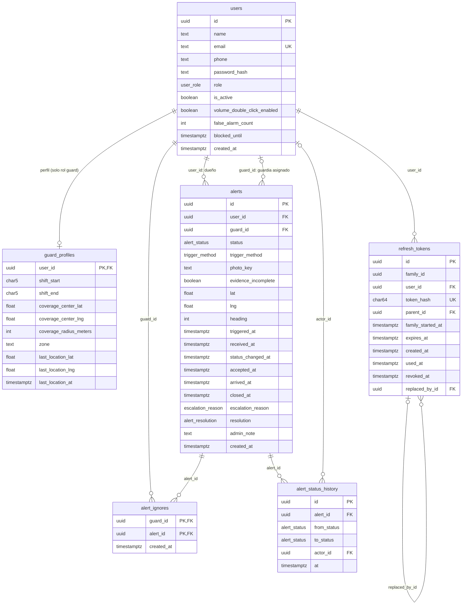
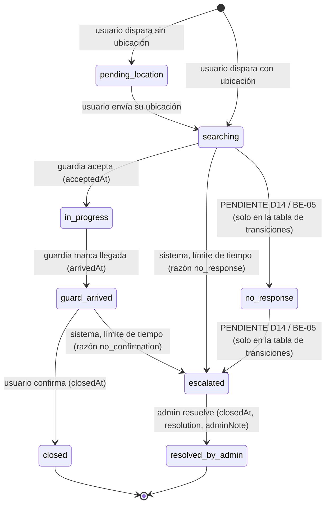

# SafeLink — Modelo de datos

**Historias que cubre:** U-01 a U-09, G-01 a G-07, A-01 a A-08 (modelo transversal del backend).
**Tarjeta:** BE-01, paso 3 (`feat(BE-01): modelo de datos, migración inicial y semillas`).
**Fuentes verificadas:** `backend/prisma/schema.prisma`, `backend/prisma/migrations/20261112024720_init/migration.sql`, `backend/prisma/migrations/20261112030815_restricciones_extra/migration.sql`, `backend/prisma/migrations/20261112042801_refresh_family_started_at/migration.sql`, `backend/prisma/seed.ts`, `lib/dominio/regla_alerta.dart`, `lib/datos/memoria_base_datos.dart`. Decisiones relacionadas en `docs/DECISIONES.md` (D1, D2, D5, D8, D10, D13, D14, D15, D17, D18, D23, D24, D25); formas JSON en `docs/API_CONTRATO.md`.

Si este documento y el código discrepan, gana el código y se reporta; no se corrige a ciegas.

---

## 1. Resumen y convenciones

- Motor: PostgreSQL 16, gestionado con Prisma. La migración inicial es `20261112024720_init`; incluye a mano lo que Prisma no puede expresar (CHECK e índice único parcial). Una segunda migración, `20261112030815_restricciones_extra`, agrega más CHECK (sección 9).
- Seis tablas: `users`, `guard_profiles`, `alerts`, `alert_ignores`, `alert_status_history`, `refresh_tokens`.
- Tablas y columnas en `snake_case`; el JSON de la API en `camelCase` (el mapeo lo hace Prisma con `@map` / `@@map`).
- Identificadores: UUID generados por la base (`gen_random_uuid()`); en JSON viajan como string (D10). La semilla usa UUID v5 deterministas.
- Fechas: `timestamptz(3)` (milisegundos), siempre UTC. La API las devuelve en ISO 8601 con `Z`.
- Unidades: distancias en **metros**, tiempos en **segundos**, rumbo (`heading`) entero **0–359**. Coordenadas como `double precision` (D17, sin PostGIS).
- **Baja lógica:** los usuarios no se borran; `users.is_active = false` los da de baja. Por eso las llaves foráneas hacia `users` son `Restrict` en alertas (sección 5).
- Enums de Postgres (nombres en `snake_case`, valores iguales a los del front):

| Tipo SQL | Valores |
|---|---|
| `user_role` | `protected_user`, `guard`, `admin` |
| `alert_status` | `pending_location`, `searching`, `in_progress`, `guard_arrived`, `closed`, `no_response`, `escalated`, `resolved_by_admin` |
| `trigger_method` | `tap`, `hold`, `shake` (en la app, `shake` se muestra como "doble clic de volumen") |
| `escalation_reason` | `no_response`, `no_confirmation` |
| `alert_resolution` | `resolved`, `false_alarm`, `service_incident` |

- Configuración que **no** vive en la base (D11): geocerca, tiempos de escalamiento, `ADMIN_NOTE_MAX_LENGTH`, rango del radio, `TZ_SHIFTS`, etc. salen de variables de entorno (`backend/src/config/env.ts`).

---

## 2. Diagrama entidad-relación



Cardinalidades en palabras:

- Un usuario con rol `guard` tiene exactamente un `guard_profiles` (1 a 0..1 desde `users`; la base no impide crear el perfil de un usuario que no sea guardia, eso lo valida la aplicación).
- Un usuario (`protected_user`) tiene 0..N alertas; **a lo más una activa** (índice parcial, sección 4).
- Un guardia puede estar asignado a 0..N alertas (`alerts.guard_id`, nulo mientras nadie acepta).
- `alert_ignores` es una tabla de unión guardia–alerta (llave compuesta).
- Una alerta tiene 0..N filas de historial de estados.
- Un usuario tiene 0..N refresh tokens; cada token puede apuntar a su predecesor (`parent_id`) y a su sucesor (`replaced_by_id`).

---

## 3. Diccionario de datos

Columna "JSON": campo del contrato (`docs/API_CONTRATO.md`) o **interno** si no se expone.

### 3.1 `users`

Cubre U-01/U-02 (registro e inicio de sesión), U-03/U-04 (bloqueo), A-01 a A-08 (administración de usuarios y guardias).

| Columna | Tipo | Nulo | Default | Restricción / índice | Descripción | JSON |
|---|---|---|---|---|---|---|
| `id` | `uuid` | no | `gen_random_uuid()` | PK | Identificador | `id` |
| `name` | `text` | no | — | CHECK `users_name_len_chk` (≤ 200) | Nombre completo | `name` |
| `email` | `text` | no | — | **único** (`users_email_key`); CHECK `email = lower(email)`; CHECK `users_email_len_chk` (≤ 254) | Correo, guardado en minúsculas y recortado (D18) | `email` |
| `phone` | `text` | no | — | CHECK `users_phone_len_chk` (≤ 30) | Teléfono | `phone` |
| `password_hash` | `text` | no | — | — | Hash argon2id de la contraseña | **interno** (nunca se devuelve) |
| `role` | `user_role` | no | — | — | Rol | `role` |
| `is_active` | `boolean` | no | `true` | — | Baja lógica; `false` = dado de baja (D8) | `isActive` |
| `volume_double_click_enabled` | `boolean` | no | `false` | — | Ajuste "doble clic de volumen" (método `shake`); el front lo apaga por defecto | `volumeDoubleClickEnabled` |
| `false_alarm_count` | `integer` | no | `0` | CHECK `>= 0` | Falsas alarmas acumuladas (A-08) | `falseAlarmCount` |
| `blocked_until` | `timestamptz(3)` | sí | — | — | Fin del bloqueo temporal; nulo = sin bloqueo | `blockedUntil` |
| `created_at` | `timestamptz(3)` | no | `CURRENT_TIMESTAMP` | — | Alta de la cuenta | `createdAt` |

El bloqueo (A-08): al resolver una alerta como `false_alarm` se suma 1 a `false_alarm_count` y, si llega al límite configurado, se fija `blocked_until` (`ReglaAlerta.aplicarFalsaAlarma`). Desbloquear pone `blocked_until = null` y `false_alarm_count = 0` (D6 punto 13). La forma exacta del JSON `User` está en `docs/API_CONTRATO.md`; esta tabla solo indica el origen de cada campo.

### 3.2 `guard_profiles`

Cubre G-01 a G-07 (disponibilidad, cobertura, ubicación) y A-02/A-03 (alta y cobertura de guardias).

| Columna | Tipo | Nulo | Default | Restricción / índice | Descripción | JSON |
|---|---|---|---|---|---|---|
| `user_id` | `uuid` | no | — | PK y FK a `users(id)` (Cascade) | Guardia dueño del perfil | `userId` / `id` del guardia (ver contrato) |
| `shift_start` | `char(5)` | no | — | CHECK de formato `HH:mm` (00:00–23:59) | Inicio del turno | `shiftStart` |
| `shift_end` | `char(5)` | no | — | CHECK de formato `HH:mm` | Fin del turno | `shiftEnd` |
| `coverage_center_lat` | `double precision` | sí | — | CHECK −90..90 | Latitud del centro de cobertura | `coverageCenter.lat` |
| `coverage_center_lng` | `double precision` | sí | — | CHECK −180..180 | Longitud del centro de cobertura | `coverageCenter.lng` |
| `coverage_radius_meters` | `integer` | sí | — | CHECK `> 0` (el rango real se valida en la app) | Radio de cobertura en metros | `coverageRadiusMeters` |
| `zone` | `text` | sí | — | CHECK `guard_profiles_zone_len_chk` (≤ 100) | Etiqueta de zona; **no** se usa para decidir visibilidad (D22) | `zone` |
| `last_location_lat` | `double precision` | sí | — | CHECK −90..90 | Última latitud reportada | `lastLocation.lat` |
| `last_location_lng` | `double precision` | sí | — | CHECK −180..180 | Última longitud reportada | `lastLocation.lng` |
| `last_location_at` | `timestamptz(3)` | sí | — | — | Cuándo se reportó la última ubicación | `lastLocationAt` |

Los nombres exactos de los campos anidados (`coverageCenter`, `lastLocation`) y los datos del usuario que acompañan al perfil (`name`, `email`, `isActive`…) se toman de la forma `GuardProfile` / `Guard` de `docs/API_CONTRATO.md`; las columnas de coordenadas se agrupan en un objeto `{ lat, lng }` al serializar.

**"Turnos" de la tarjeta = `shift_start` / `shift_end` (D1).** No existe tabla `shifts`: el front modela un turno por guardia. Reglas (`lib/dominio/regla_turno.dart`):

- Formato `HH:mm`, validado por CHECK.
- El turno es `[inicio, fin)`.
- Puede **cruzar medianoche** (por ejemplo `22:00`–`06:00`).
- `inicio = fin` significa turno de **24 horas**.
- Se evalúa en la zona horaria `TZ_SHIFTS` (`America/Mexico_City` por defecto, D12), no en UTC. La base solo guarda el texto; la evaluación "¿está en turno ahora?" la hace la aplicación.

### 3.3 `alerts`

Cubre U-03 a U-09, G-02 a G-06, A-04 a A-08.

| Columna | Tipo | Nulo | Default | Restricción / índice | Descripción | JSON |
|---|---|---|---|---|---|---|
| `id` | `uuid` | no | `gen_random_uuid()` | PK | Identificador | `id` |
| `user_id` | `uuid` | no | — | FK `users(id)` Restrict; índice `alerts_user_id_idx`; parte del índice único parcial | Usuario que dispara | `userId` |
| `guard_id` | `uuid` | sí | — | FK `users(id)` Restrict; índice `alerts_guard_id_idx`; CHECK `alerts_guard_not_user_chk` (≠ `user_id`); CHECK `alerts_guard_required_chk` (obligatorio en `in_progress`, `guard_arrived` y `closed`) | Guardia asignado; nulo hasta que alguien acepta | `guardId` |
| `status` | `alert_status` | no | — | índice `alerts_status_idx`; condiciona el índice parcial | Estado actual (sección 6) | `status` |
| `trigger_method` | `trigger_method` | no | — | — | Cómo se disparó | `triggerMethod` |
| `photo_key` | `text` | sí | — | CHECK `alerts_photo_key_format_chk` (nulo o UUID en minúsculas) | Llave de la foto en `PhotoStorage` (D2) | **interno** (alimenta `photoUrl`) |
| `evidence_incomplete` | `boolean` | no | `false` | — | `true` cuando no hay foto | `evidenceIncomplete` |
| `lat` | `double precision` | sí | — | CHECK −90..90 | Latitud de la alerta; nula en `pending_location` | `location.lat` |
| `lng` | `double precision` | sí | — | CHECK −180..180 | Longitud de la alerta | `location.lng` |
| `heading` | `integer` | sí | — | CHECK 0..359 | Rumbo en grados | `heading` |
| `triggered_at` | `timestamptz(3)` | no | — | — | Hora **del dispositivo**; solo se guarda y se devuelve (D24) | `triggeredAt` |
| `received_at` | `timestamptz(3)` | no | `CURRENT_TIMESTAMP` | índice `alerts_received_at_idx` | Hora **del servidor** al recibir `POST /alerts`; base de todo lo calculado (D24) | **interno** |
| `status_changed_at` | `timestamptz(3)` | no | `CURRENT_TIMESTAMP` | — | Cuándo entró al estado actual; base de los temporizadores de escalamiento (D5) | **interno** |
| `accepted_at` | `timestamptz(3)` | sí | — | — | Cuándo aceptó el guardia | `acceptedAt` |
| `arrived_at` | `timestamptz(3)` | sí | — | — | Cuándo llegó el guardia | `arrivedAt` |
| `closed_at` | `timestamptz(3)` | sí | — | CHECK `alerts_closed_at_required_chk` (obligatorio en `closed` y `resolved_by_admin`) | Cierre por el usuario, o resolución del admin | `closedAt` |
| `escalation_reason` | `escalation_reason` | sí | — | — | Por qué se escaló | `escalationReason` |
| `resolution` | `alert_resolution` | sí | — | — | Resolución del admin | `resolution` |
| `admin_note` | `text` | sí | — | CHECK `char_length <= 1000` (tope de cordura; el real es `ADMIN_NOTE_MAX_LENGTH`) | Nota del admin al resolver | `adminNote` |
| `created_at` | `timestamptz(3)` | no | `CURRENT_TIMESTAMP` | — | Alta del registro | **interno** (no aparece en el JSON `Alert`) |

**Campos JSON calculados** (no son columnas de `alerts`; ver `docs/API_CONTRATO.md`):

| Campo JSON | De dónde sale |
|---|---|
| `userName` | `users.name` del dueño (`alerts.user_id`) |
| `userPhone` | `users.phone` del dueño, con la minimización de D23 (el guardia solo lo ve si es el asignado y la alerta sigue activa) |
| `guardName` | `users.name` del guardia (`alerts.guard_id`); `null` sin guardia |
| `etaSeconds` | **Se calcula en cada lectura, sin columna (D27).** Solo con la alerta en `in_progress`: distancia Haversine entre `guard_profiles.last_location_lat/lng` y `alerts.lat/lng`, entre `GUARD_METERS_PER_MINUTE`, convertida a segundos y redondeada a entero. `null` si falta alguna de las dos ubicaciones o la alerta no está en `in_progress` |
| `photoUrl` | `PhotoStorage.url(alerts.photo_key)`; `null` sin foto (D2). Se conserva para el guardia asignado aunque la alerta ya no esté activa (D23) |

Además, para la lista priorizada, `distanceMeters`, `waitingMinutes` y `score` se calculan con `received_at` (D24), no se guardan.

Notas de uso de las marcas de tiempo: ver sección 6.

### 3.4 `alert_ignores`

Cubre G-05 (el guardia ignora una alerta: `POST /guard/alerts/:id/ignore`, D5). Equivale a `datos/memoria_base_datos.dart:47-48`.

| Columna | Tipo | Nulo | Default | Restricción / índice | Descripción | JSON |
|---|---|---|---|---|---|---|
| `guard_id` | `uuid` | no | — | PK compuesta; FK `users(id)` Cascade | Guardia que ignora | **interno** |
| `alert_id` | `uuid` | no | — | PK compuesta; FK `alerts(id)` Cascade | Alerta ignorada | **interno** |
| `created_at` | `timestamptz(3)` | no | `CURRENT_TIMESTAMP` | — | Cuándo la ignoró | **interno** |

Se usa solo para filtrar lo que ve cada guardia (visibilidad de D22); no se expone.

### 3.5 `alert_status_history`

Cubre A-05 (consulta de historial y trazabilidad) y las métricas de BE-07 (D5).

| Columna | Tipo | Nulo | Default | Restricción / índice | Descripción | JSON |
|---|---|---|---|---|---|---|
| `id` | `uuid` | no | `gen_random_uuid()` | PK | Identificador | **interno** |
| `alert_id` | `uuid` | no | — | FK `alerts(id)` Cascade; índice compuesto `(alert_id, at)` | Alerta | **interno** |
| `from_status` | `alert_status` | sí | — | — | Estado anterior; nulo al crear la alerta | **interno** |
| `to_status` | `alert_status` | no | — | — | Estado nuevo | **interno** |
| `actor_id` | `uuid` | sí | — | FK `users(id)` SetNull | Quién hizo el cambio; nulo si lo hizo el sistema (escalamiento) | **interno** |
| `at` | `timestamptz(3)` | no | `CURRENT_TIMESTAMP` | — | Momento del cambio | **interno** |

Estado actual de la implementación: el esquema y la semilla ya contemplan el historial; la escritura en cada transición se implementa con las rutas de alertas (BE-03 a BE-05). Hasta entonces solo la semilla lo llena.

### 3.6 `refresh_tokens`

Cubre las sesiones (D8, D25). **Toda la tabla es interna**: ningún campo viaja en el JSON; al cliente solo llega el token opaco en `refreshToken`.

| Columna | Tipo | Nulo | Default | Restricción / índice | Descripción |
|---|---|---|---|---|---|
| `id` | `uuid` | no | `gen_random_uuid()` | PK | Identificador |
| `family_id` | `uuid` | no | — | índice `refresh_tokens_family_id_idx` | Id de la sesión (claim `sid` del access token). Toda la rotación comparte familia |
| `user_id` | `uuid` | no | — | FK `users(id)` Cascade; índice `refresh_tokens_user_id_idx` | Dueño |
| `token_hash` | `char(64)` | no | — | **único** (`refresh_tokens_token_hash_key`); CHECK `refresh_tokens_token_hash_format_chk` (`^[0-9a-f]{64}$`) | SHA-256 en hexadecimal del token opaco; nunca se guarda el token (D25) |
| `parent_id` | `uuid` | sí | — | FK `refresh_tokens(id)` SetNull | Token del que se rotó |
| `family_started_at` | `timestamptz(3)` | no | `CURRENT_TIMESTAMP` | — | Inicio de la sesión (se copia a cada sucesor). Sirve para la vida máxima absoluta `JWT_SESSION_MAX_AGE` (D25). La migración rellenó las filas existentes con el `created_at` más antiguo de su familia |
| `expires_at` | `timestamptz(3)` | no | — | — | Vencimiento: `min(emisión + JWT_REFRESH_EXPIRES_IN, family_started_at + JWT_SESSION_MAX_AGE)` (30 días y 90 días por defecto, D8, D25) |
| `created_at` | `timestamptz(3)` | no | `CURRENT_TIMESTAMP` | — | Emisión |
| `used_at` | `timestamptz(3)` | sí | — | — | Cuándo se usó para rotar; reutilizarlo fuera de la ventana de gracia (`REFRESH_GRACE_SECONDS`) revoca la familia (D25) |
| `revoked_at` | `timestamptz(3)` | sí | — | — | Revocación (logout, baja, reutilización, hermano de gracia sin usar) |
| `replaced_by_id` | `uuid` | sí | — | FK `refresh_tokens(id)` SetNull | Sucesor emitido en la rotación (para la ventana de gracia, D25) |

---

## 4. Restricciones e índices

**CHECK (migración, sección escrita a mano):**

| Tabla | Nombre | Regla | Origen |
|---|---|---|---|
| `users` | `users_email_lowercase_chk` | `email = lower(email)` | D18 |
| `users` | `users_false_alarm_count_chk` | `false_alarm_count >= 0` | — |
| `guard_profiles` | `guard_profiles_shift_format_chk` | `shift_start` y `shift_end` cumplen `^([01][0-9]\|2[0-3]):[0-5][0-9]$` | D1 |
| `guard_profiles` | `guard_profiles_coverage_chk` | lat −90..90, lng −180..180 (centro y última ubicación), radio `> 0`; cada uno puede ser nulo | D17 |
| `alerts` | `alerts_lat_chk` | `lat` nulo o −90..90 | D17 |
| `alerts` | `alerts_lng_chk` | `lng` nulo o −180..180 | D17 |
| `alerts` | `alerts_heading_chk` | `heading` nulo o 0..359 | — |
| `alerts` | `alerts_admin_note_len_chk` | `admin_note` nulo o ≤ 1000 caracteres | D17 / tope de cordura |

Los nueve CHECK de la segunda migración (`restricciones_extra`) están en la sección 9.

**Únicos:** `users_email_key` (`users.email`), `refresh_tokens_token_hash_key` (`refresh_tokens.token_hash`), y las llaves primarias (incluida la compuesta `(guard_id, alert_id)` de `alert_ignores`).

**Índice único parcial (D15):**

```sql
CREATE UNIQUE INDEX "alerts_one_active_per_user_idx" ON "alerts"("user_id")
  WHERE "status" IN ('pending_location', 'searching', 'in_progress', 'guard_arrived');
```

Garantiza **una sola alerta activa por usuario**, aun con dos peticiones simultáneas. Refleja el supuesto del front "nadie tiene dos a la vez" (`memoria_base_datos.dart:116-117`). La violación debe traducirse en `409 INVALID_STATE` (D22). Prisma no puede expresar índices parciales, así que **vive solo en la migración**: si alguien regenera la migración desde el esquema, hay que conservarlo.

**Índices no únicos:** `alerts_status_idx`, `alerts_guard_id_idx`, `alerts_user_id_idx`, `alerts_received_at_idx`, `alert_status_history_alert_id_at_idx (alert_id, at)`, `refresh_tokens_user_id_idx`, `refresh_tokens_family_id_idx`. `alert_ignores` no tiene índice aparte sobre `alert_id`; la PK compuesta cubre las búsquedas por `guard_id`.

**Qué se valida en la aplicación y no en la base, y por qué:**

- **Rango del radio de cobertura (500–10000 m):** los límites vienen de `COVERAGE_RADIUS_MIN_METERS` y `COVERAGE_RADIUS_MAX_METERS` (`env.ts`). Un CHECK los fijaría en la migración y cambiarlos exigiría una migración nueva. La base solo exige `> 0`.
- **Largo máximo de la nota del admin (300):** viene de `ADMIN_NOTE_MAX_LENGTH`. La base solo pone un tope holgado de 1000 como red de seguridad.
- La migración `restricciones_extra` (sección 9) ya exige `guard_id` en `in_progress`, `guard_arrived` y `closed`, y `closed_at` en `closed` y `resolved_by_admin`. Siguen sin validarse en la base: `resolution` solo en `resolved_by_admin`, `closed_at` ausente en estados activos, y que `guard_profiles`, `alerts.guard_id` y `alert_ignores.guard_id` pertenezcan a un usuario de rol `guard`. Es responsabilidad de la capa de servicio.

---

## 5. Políticas de borrado

| FK | Política | Por qué |
|---|---|---|
| `alerts.user_id` → `users` | **Restrict** | Los usuarios se dan de baja de forma lógica; borrar uno con alertas perdería el historial y las métricas |
| `alerts.guard_id` → `users` | **Restrict** | Mismo motivo: la alerta debe conservar quién la atendió |
| `guard_profiles.user_id` → `users` | **Cascade** | El perfil no existe sin su usuario |
| `alert_ignores.guard_id` → `users` | **Cascade** | Dato auxiliar de visibilidad; sin guardia no tiene sentido |
| `alert_ignores.alert_id` → `alerts` | **Cascade** | Ídem, sin la alerta |
| `alert_status_history.alert_id` → `alerts` | **Cascade** | El historial es parte de la alerta |
| `alert_status_history.actor_id` → `users` | **SetNull** | Se conserva la transición aunque el actor desaparezca (queda como "sistema") |
| `refresh_tokens.user_id` → `users` | **Cascade** | Las sesiones no sobreviven al usuario |
| `refresh_tokens.parent_id` / `replaced_by_id` → `refresh_tokens` | **SetNull** | Una limpieza de tokens viejos no debe fallar por la cadena de rotación |

Todas las FK usan `ON UPDATE CASCADE`. Como los usuarios no se borran en operación normal, Cascade y SetNull solo actúan en limpiezas manuales o en `db:reset`.

---

## 6. Máquina de estados de la alerta

**Estados activos** (`ReglaAlerta` / `EstadoAlerta.activa`): `pending_location`, `searching`, `in_progress`, `guard_arrived`. Son los que cubre el índice parcial de D15.
**Estados no activos:** `closed` y `resolved_by_admin` (terminales), `escalated` (espera al admin), `no_response` (ver D14).

### 6.1 Transiciones que hace el código real del front



Las dos últimas flechas **no las ejecuta ningún código del front**; se muestran porque la tabla `_transiciones` de `regla_alerta.dart:12-21` las permite y porque el estado `no_response` existe en el contrato y en la semilla.

| Transición | Quién la dispara | Evidencia en el front | Marcas de tiempo que llena |
|---|---|---|---|
| (creación) → `pending_location` / `searching` | Usuario | `memoria_alerta_usuario_repository.dart:31` (según haya o no ubicación) | `triggered_at` (dispositivo), `received_at` y `status_changed_at` (servidor) |
| `pending_location` → `searching` | Usuario (envía ubicación) | `memoria_alerta_usuario_repository.dart:55` | `status_changed_at` |
| `searching` → `in_progress` | Guardia (aceptar) | `memoria_alerta_guardia_repository.dart:61` | `accepted_at`, `guard_id`, `status_changed_at` (`etaSeconds` se calcula en cada lectura, D27) |
| `in_progress` → `guard_arrived` | Guardia (llegué, con geocerca) | `memoria_alerta_guardia_repository.dart:94` | `arrived_at`, `status_changed_at` |
| `guard_arrived` → `closed` | Usuario (confirma atención) | `memoria_alerta_usuario_repository.dart:68` | `closed_at`, `status_changed_at` |
| `searching` / `guard_arrived` → `escalated` | Sistema (temporizador) | `memoria_base_datos.dart:189-203` | `escalation_reason`, `status_changed_at`; **no** se llena `closed_at` |
| `escalated` → `resolved_by_admin` | Admin | `memoria_admin_repository.dart:123` | `closed_at`, `resolution`, `admin_note`, `status_changed_at` |

Notas:

- `status_changed_at` se actualiza en **cada** transición; es la referencia de los temporizadores de escalamiento (D5), y `received_at` la del tiempo total de espera (D24).
- Al resolver con `false_alarm` se aplica la regla de falsas alarmas al usuario (`false_alarm_count`, `blocked_until`).
- Desde `in_progress` nunca se escala (`razonParaEscalar` solo actúa en `searching`, `no_response` y `guard_arrived`).
- **Historial (`alert_status_history`):** cada transición agrega una fila `(alert_id, from_status, to_status, actor_id, at)`. `from_status` es nulo en la creación; `actor_id` es el usuario, el guardia o el admin que actúa, y nulo cuando lo hace el sistema (escalamiento). Ver el aviso de la sección 3.5 sobre cuándo se empieza a escribir.

### 6.2 Inconsistencia D14 (pendiente de BE-05)

Hay dos fuentes del front que no coinciden:

1. **Tabla de transiciones** (`regla_alerta.dart:12-21`): `searching → no_response → escalated`. `puedeTransicionar` **no se llama** en ningún lado.
2. **Lo que hace la simulación** (`memoria_base_datos.dart:189-203`): al vencer el límite pasa **directo a `escalated`** desde `searching`; el estado `no_response` nunca se asigna. `razonParaEscalar` devuelve la razón `no_response` para `searching` **y** `no_response`.
3. `no_response` como **estado** solo aparece en la semilla del front (`datos_semilla.dart:286`, alerta `alt-204`, sin guardia). La razón `escalation_reason = no_response` no equivale al estado `status = no_response` (la métrica `noResponseRate` cuenta por la razón).

**Pendiente de BE-05:** decidir si `no_response` es un paso intermedio persistente o se omite, y alinear tabla y escalamiento. No debe implementarse el escalamiento antes de cerrar D14. Mientras tanto, el esquema admite los ocho estados y ambas razones.

La semilla refleja la ambigüedad a propósito: `alt-204` está en `no_response` (historial `searching → no_response`), pero las escaladas sin guardia (`alt-301`) pasan directo `searching → escalated`.

---

## 7. Semilla de desarrollo (D13)

Archivo: `backend/prisma/seed.ts`. Equivale a `lib/datos/datos_semilla.dart` en cuentas, perfiles y alertas activas, **sin historial sintético** (va con las métricas, BE-07).

**Qué crea (conteos verificados contra el código):**

| Elemento | Cantidad | Detalle |
|---|---|---|
| Cuentas | 44 | 1 admin, 8 guardias, 35 usuarios protegidos (`usr-1` a `usr-35`) |
| Perfiles de guardia | 8 | `grd-1` a `grd-8` |
| Alertas | 30 | 22 `searching`, 1 `pending_location`, 1 `in_progress`, 1 `guard_arrived`, 1 `no_response`, 3 `escalated`, 1 `resolved_by_admin` |
| Historial de estados | variable | Una fila por cada transición de cada alerta sembrada |

Son 25 alertas activas y 5 no activas: las activas y las no activas que siembra el front.

**Cuentas demo** (contraseña de demostración `SafeLink1`, **solo para desarrollo local**; todas las cuentas la comparten):

| Rol | Correo | Nota |
|---|---|---|
| `admin` | `admin@safelink.mx` | Mariana Ortega Ruiz |
| `guard` | `guardia@safelink.mx` | `grd-1`, Carlos Hernández López, en turno |
| `guard` | `guardia.noche@safelink.mx` | `grd-4`, turno `22:00`–`06:00` |
| `protected_user` | `usuario@safelink.mx` | `usr-1`, doble clic de volumen activado |
| `protected_user` | `bloqueado@safelink.mx` | `usr-4`, 3 falsas alarmas, bloqueado 5 días |

Otros casos útiles: `grd-5` (`luis.nava@safelink.mx`) está dado de baja (`is_active = false`); `grd-7` está fuera de turno; `grd-8` es nuevo, sin cobertura ni zona, turno `08:00`–`16:00`.

**UUID v5 deterministas (D10):** el id de cada registro es `UUID v5(namespace fijo 5afe11c0-0000-4000-8000-000000000001, clave del front)`, con claves como `adm-1`, `grd-1`, `usr-1`, `alt-101`. La foto de cada alerta usa `photo:<clave>` y el historial `history:<clave>:<n>`. Así los ids son iguales entre corridas y entre equipos.

**Turnos relativos:** `grd-1`, `grd-2`, `grd-3` y `grd-6` quedan **en turno** (empieza hace 2 h, termina en 6 h); `grd-5` y `grd-7` **fuera de turno** (de +3 h a +11 h); `grd-4` es fijo nocturno. Las horas `HH:mm` se calculan en `TZ_SHIFTS`. Las fechas de las alertas también son relativas a "ahora".

**Idempotente:** todo se `upsert`a por id; las alertas sembradas se reinician (estado, fechas e historial) en cada corrida. Las alertas `searching` incluyen casos sin foto (`evidence_incomplete = true`).

**Protección:** la semilla **solo corre con `NODE_ENV` `development` o `test`**; con cualquier otro valor (por ejemplo `production`) termina con error y no cambia nada. También exige `DATABASE_URL`. Los tiempos de escalamiento de las escaladas sembradas usan `ACCEPT_TIMEOUT_SECONDS` y `CONFIRM_TIMEOUT_SECONDS`.

**Cómo correrla:** `npm run db:seed` (ejecuta `tsx prisma/seed.ts`, configurado en `backend/prisma.config.ts`).

---

## 8. Comandos

Se corren desde `backend/`.

| Comando | Qué hace |
|---|---|
| `npm run db:up` | Levanta Postgres con Docker Compose (`docker compose up -d db`) |
| `npm run db:generate` | Genera el cliente de Prisma (`src/generated/prisma`) |
| `npm run db:migrate` | `prisma migrate dev`: crea y aplica migraciones en desarrollo |
| `npm run db:deploy` | `prisma migrate deploy`: aplica las migraciones pendientes sin borrar datos |
| `npm run db:seed` | Corre la semilla (sección 7) |
| `npm run db:reset` | `prisma migrate reset --force`: **borra todo** y reaplica las migraciones. En Prisma 7 ya no siembra sola: después hay que correr `npm run db:seed`. Lo debe ejecutar la persona, no un agente |
| `npm run db:test:create` | Crea la base de pruebas (`DATABASE_URL_TEST`, debe terminar en `_test`) dentro del contenedor `db` |
| `npm run db:test:deploy` | Aplica las migraciones pendientes a la base de pruebas |
| `npm run db:test:reset` | Reaplica todas las migraciones desde cero en la base de pruebas, sin semilla |

Orden típico en una máquina nueva: `db:up` → `db:deploy` (o `db:migrate`) → `db:seed`. Para pruebas de integración: `db:test:create` → `db:test:deploy`.

---

## 9. Segunda migración `restricciones_extra`

La migración `20261112030815_restricciones_extra` endurece la inicial con más CHECK (defensa en profundidad). Nombres verificados contra su `migration.sql`:

| Tabla | Restricción | Regla |
|---|---|---|
| `refresh_tokens` | `refresh_tokens_token_hash_format_chk` | `token_hash` cumple `^[0-9a-f]{64}$` (SHA-256 en hex minúsculas) |
| `alerts` | `alerts_guard_not_user_chk` | `guard_id` nulo o distinto de `user_id` |
| `alerts` | `alerts_guard_required_chk` | los estados `in_progress`, `guard_arrived` y `closed` exigen `guard_id` |
| `alerts` | `alerts_closed_at_required_chk` | los estados `closed` y `resolved_by_admin` exigen `closed_at` |
| `alerts` | `alerts_photo_key_format_chk` | `photo_key` nulo o UUID en minúsculas |
| `users` | `users_name_len_chk` | `name` ≤ 200 caracteres |
| `users` | `users_email_len_chk` | `email` ≤ 254 caracteres |
| `users` | `users_phone_len_chk` | `phone` ≤ 30 caracteres |
| `guard_profiles` | `guard_profiles_zone_len_chk` | `zone` nulo o ≤ 100 caracteres |

Esto reduce lo que la sección 4 deja a la capa de servicio (coherencia `status` / `guard_id` / `closed_at`). Siguen sin poder expresarse como CHECK: que `guard_id` y `alert_ignores.guard_id` sean usuarios con rol `guard`, y que `guard_profiles` pertenezca a un guardia (lo valida la API; ver "Pendientes de seguridad" en `docs/DECISIONES.md`).

**Cliente Prisma:** omite `passwordHash` por defecto en las consultas; solo el login lo pide explícitamente.

---

## 10. Discrepancias encontradas

1. **Tope de la nota del admin:** el contrato dice 300 (`ADMIN_NOTE_MAX_LENGTH`) y la base 1000; es intencional (sección 4), no un error.
2. **D14 sigue abierta:** la semilla incluye transiciones (`searching → escalated` directo y `searching → no_response`) que la tabla de `regla_alerta.dart` solo permite parcialmente; se mantiene hasta BE-05.
3. **`created_at` y `status_changed_at`/`received_at`** no están en el JSON `Alert` del contrato; es consistente con D24 y D5 (internos).
